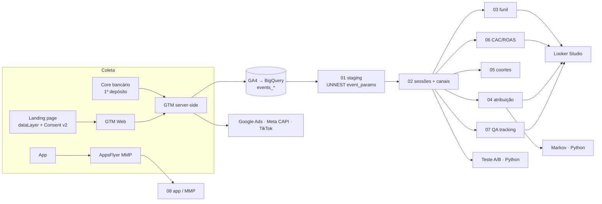
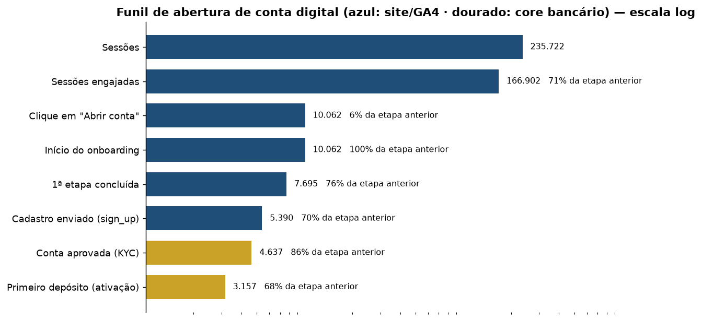
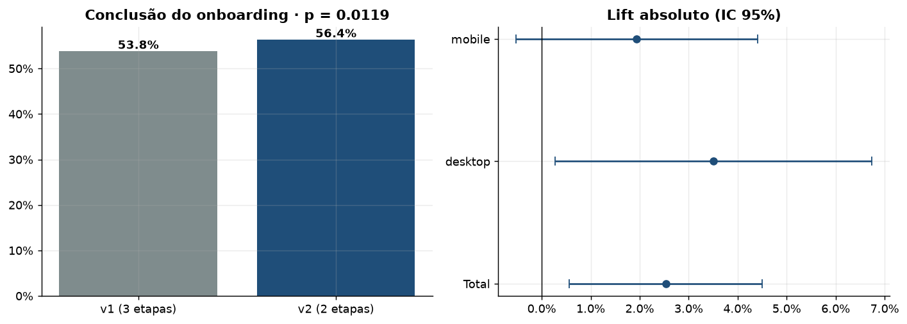
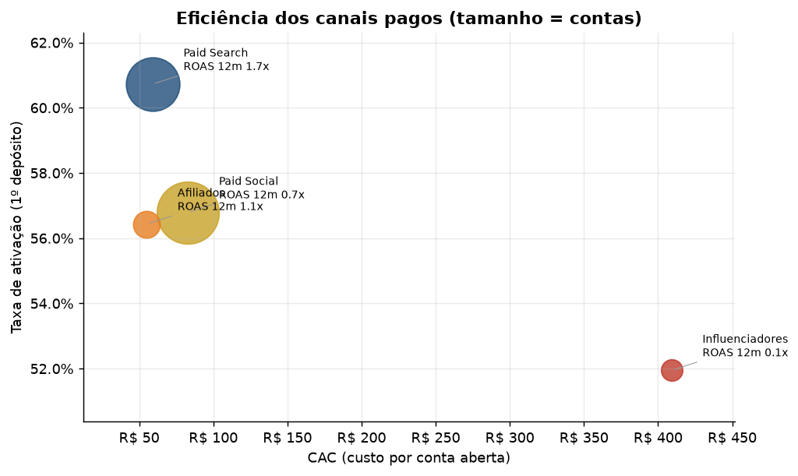
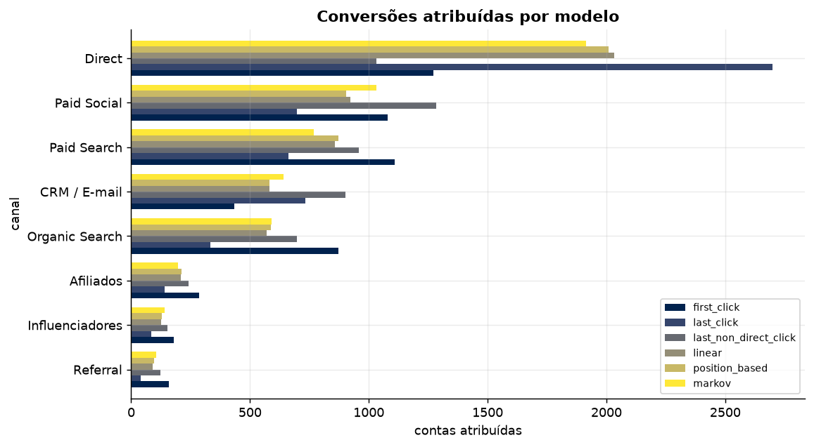

# Digital Account Funnel: tracking e analytics de um onboarding bancário

> Projeto de **Web Analytics ponta a ponta** para a abertura de conta de um banco digital fictício: plano de tracking, landing page com `dataLayer` e Consent Mode v2, container GTM, arquitetura server-side, SQL no schema real do **GA4 → BigQuery**, funil, atribuição multitoque (incluindo Markov), teste A/B, dados de MMP e QA de dados.


🔗 **Demo ao vivo da landing page com o dataLayer na tela:** https://viniciusg20.github.io/digital-account-funnel/

---

## O problema

O banco investe em mídia para captar contas digitais, mas:
- não sabe **onde o onboarding perde clientes**;
- compara canais pelo custo por cadastro, sem olhar **quem deposita de verdade**;
- tem UTMs inconsistentes e conversões duplicadas, e **não confia nos números**;
- quer saber se o novo formulário de 2 etapas é melhor que o de 3.

## O que foi construído



| Peça | Arquivo | Requisito da vaga |
|---|---|---|
| Plano de tracking (eventos, parâmetros, KPIs, QA) | [`tracking/plano_de_tracking.md`](tracking/plano_de_tracking.md) | GA4, eventos, parâmetros, conversões |
| Landing page com `dataLayer`, Consent Mode v2 e A/B | [`site/`](site) | Implementação de tracking |
| Container GTM (GA4, Google Ads, Meta Pixel com consentimento) | [`tracking/gtm/container_web.json`](tracking/gtm/container_web.json) | Google Tag Manager, pixels |
| Arquitetura server-side + deduplicação + CAPI | [`tracking/gtm/server_side.md`](tracking/gtm/server_side.md) | GTM Server-Side, sinais de mídia |
| Taxonomia de UTMs + validador | [`tracking/taxonomia_utm.md`](tracking/taxonomia_utm.md), [`utm_builder.py`](tracking/utm_builder.py) | UTMs |
| Gerador de dados no schema do export GA4 + AppsFlyer | [`src/funnel/simulate.py`](src/funnel/simulate.py) | MMP (AppsFlyer) |
| SQL: staging (BigQuery e DuckDB), sessões, funil, atribuição, coortes, CAC/ROAS, QA, app | [`sql/`](sql) | SQL, funil, e-commerce/digital |
| Teste A/B (SRM, z-teste, poder, Bayes) | [`src/funnel/ab_test.py`](src/funnel/ab_test.py) | Análise e inconsistências |
| Atribuição de Markov | [`src/funnel/markov.py`](src/funnel/markov.py) | Funil e métricas |
| Painel | [`looker_studio/`](looker_studio) | Looker Studio |

## Principais resultados

Base simulada: **90 mil novos usuários, 236 mil sessões e 835 mil eventos GA4** em 61 dias (ago–set/2026).

### 1. Funil: o gargalo é o clique no CTA, e o formulário perde 30% na reta final
<p align="center"></p>

| Etapa | Volume | Conversão da etapa |
|---|---|---|
| Sessões | 235.722 | – |
| Engajadas | 166.902 | 71% |
| Início do onboarding | 10.062 | 6,0% |
| Cadastro enviado | 5.390 | 54% do início |
| Conta aprovada (KYC) | 4.637 | 86% |
| **Primeiro depósito** | **3.157** | 68% |

### 2. Teste A/B: o formulário de 2 etapas ganha, mas o teste estava no limite do poder
<p align="center"></p>

- Conclusão do onboarding: **53,8% (v1) → 56,4% (v2)**, lift de **+4,7%** (IC 95% do lift absoluto: +0,6 a +4,5 p.p.), **p = 0,012**.
- Bayes: **P(v2 > v1) = 99,4%**, com perda esperada desprezível ao escolher v2.
- **SRM ok** (4.939 × 4.845, p = 0,34).
- **Cuidado:** para detectar 5% de lift com 80% de poder seriam necessários **5.357 usuários por braço**, e o teste teve ~4.900. A decisão (v2) é boa, mas a estimativa do tamanho do efeito é imprecisa. Por dispositivo: desktop +5,8% (p = 0,03); mobile +3,9%, não significativo isoladamente (p = 0,12). O formulário mobile merece um teste próprio.

### 3. Canais: o mais barato por cadastro não é o mais eficiente
<p align="center"></p>

| Canal | Contas | CAC | Ativação | ROAS 12m* |
|---|---|---|---|---|
| Paid Search | 965 | R$ 59 | 61% | 1,7× |
| Afiliados | 241 | R$ 55 | 56% | 1,1× |
| Paid Social | 1.296 | R$ 83 | 57% | 0,7× |
| Influenciadores | 154 | R$ 409 | 52% | 0,1× |

\* receita anual estimada (3,5% sobre o 1º depósito) ÷ custo. Paid Social traz volume, mas paga menos da metade do que Search no primeiro ano. Influenciadores custam 7× mais por conta e ativam menos. Antes de cortar, vale medir o efeito de marca com um teste de incrementalidade geográfica, que a atribuição por clique não captura.

### 4. Atribuição: cada modelo conta uma história, e o last click puro é o pior
<p align="center"></p>

| % das contas | First click | Last click | Last non-direct | Markov |
|---|---|---|---|---|
| Direct | 24% | **50%** | 19% | 36% |
| Paid Social | 20% | 13% | **24%** | 19% |
| Paid Search | 21% | 12% | 18% | 14% |
| Organic Search | **16%** | 6% | 13% | 11% |
| CRM / E-mail | 8% | 14% | **17%** | 12% |

- **Last click** entrega metade das contas ao Direct: o usuário volta digitando a URL depois de ter sido trazido pela mídia.
- **CRM/E-mail fecha jornadas** (17% no last non-direct contra 8% no first click); **Organic e Search abrem** (16% e 21% no first click).
- O **Markov** (efeito de remoção) fica no meio. Comparado a ele, o last non-direct superestima o remarketing de Paid Social e o CRM.
- **Recomendação:** Markov ou position-based para distribuir verba entre canais; last non-direct só para otimização tática dentro de cada plataforma.

### 5. QA de tracking: os números estavam sujos (e agora sabemos quanto)

| Teste | Ocorrências | % |
|---|---|---|
| UTM source fora da taxonomia (`Facebook`, `ig`) | 1.636 | 1,4% |
| UTM medium com maiúscula/espaço (`Paid-Social`, `"cpc "`) | 1.676 | 1,4% |
| Google Ads só com gclid (sem utm_campaign) | 730 | 3,0% |
| **`first_deposit` duplicado (client + server)** | **45** | **1,5%** |
| Cliques pagos sem sessão medida (consentimento/bloqueio) | 17.815 | 17% |
| Usuários com jornada quebrada por troca de dispositivo | 138 | 2,6% |

A normalização (`dim_de_para_utm`) e a deduplicação por `transaction_id` já entram no modelo de dados. As causas-raiz estão documentadas no plano de tracking e na taxonomia de UTMs.

### 6. App (AppsFlyer)
3.033 installs, com 58% orgânicos. Install → cadastro fica em ~29% para Meta e Google e chega a ~38% para TikTok e afiliados. A reconciliação MMP × core bancário fecha em **100%** (899 cadastros = 899 contas).

---

## Como rodar

```bash
git clone https://github.com/viniciusg20/digital-account-funnel.git && cd digital-account-funnel
python -m venv .venv && .venv\Scripts\activate
pip install -r requirements.txt

python -m funnel.pipeline --simular      # gera ~60 dias de dados, roda o SQL, A/B, Markov, figuras e CSVs do Looker
pytest                                   # 12 testes (UTM, A/B, Markov, staging GA4)

python tracking/utm_builder.py validar "https://site.com/?utm_source=Facebook&utm_medium=Paid-Social"
```

Para abrir a landing page localmente: `python -m http.server -d site 8000` e acesse `http://localhost:8000`.

### No BigQuery de verdade
`sql/bigquery/01_stg_events.sql` roda direto sobre um export GA4 (`events_*`); os arquivos `sql/02..08` são SQL padrão e rodam no BigQuery com ajustes mínimos de dialeto (`arg_max` → `ARRAY_AGG(... ORDER BY ... LIMIT 1)`).

## Por que dados simulados?
Dados de funil de banco são confidenciais. O gerador reproduz o **schema exato** do export GA4 (event_params aninhados, `collected_traffic_source`, `user_pseudo_id`, `ga_session_id`) e as dinâmicas que importam: qualidade por canal, mobile × desktop, jornadas com várias sessões, cross-device, teste A/B com efeito real conhecido (+10%) e os erros de tracking do dia a dia. Como o efeito verdadeiro é conhecido, dá para **validar** se a análise o recupera.

---

### English summary
End-to-end web analytics project for a fictional digital bank's account-opening funnel. It covers a tracking plan, a landing page with dataLayer and Consent Mode v2 (live demo on GitHub Pages), a GTM web container, a server-side GTM/CAPI architecture with event deduplication, and a UTM taxonomy with a validator. On the data side, SQL written against the real GA4 BigQuery export schema (UNNEST event_params) produces sessionization, funnel, cohort, CAC/ROAS and multi-touch attribution tables; a Markov removal-effect model runs in Python; the A/B test analysis includes SRM, power and Bayesian checks; AppsFlyer MMP reconciliation and a tracking QA suite round it out. The dashboard is built in Looker Studio. The synthetic data plants known effects and known tracking bugs, and the analysis recovers them.

---

**Vinicius Gonzales** · [LinkedIn](https://www.linkedin.com/in/vinicius-gonzales-9a1386150/) · [Portfólio](https://viniciusg20.github.io)
