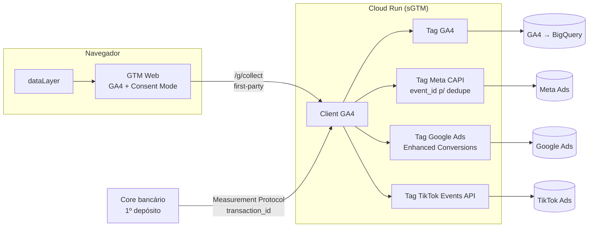

# GTM server-side e pixels: arquitetura de sinais

## Por que server-side?

| Problema do tracking só no navegador | Como o sGTM resolve |
|---|---|
| Bloqueadores e ITP do Safari cortam cookies de terceiros e scripts de pixel | Coleta em subdomínio próprio (`sgtm.aurum.example.com.br`) com cookie first-party definido pelo servidor |
| Cada pixel (Meta, TikTok, Google Ads) é um script pesado no site | O site envia **um** fluxo para o servidor, que distribui para cada plataforma |
| Conversões fora do site (1º depósito no core bancário) não passam pelo navegador | Backend envia o evento ao sGTM / Measurement Protocol |
| Dado sensível vazando para fornecedores | O servidor filtra e faz hash (SHA-256) de e-mail/telefone antes de enviar à Meta CAPI e ao Enhanced Conversions |

## Arquitetura

## Deduplicação client + server

Quando a mesma conversão sai do navegador (pixel) **e** do servidor (CAPI), as plataformas deduplicam por **`event_id`** (Meta e TikTok) ou **`transaction_id`/`orderId`** (Google). Regras:

1. O `event_id` nasce **uma vez**, no dataLayer (`tracking.js` gera um UUID por push).
2. O mesmo `event_id` vai no pixel (`fbq('track', ..., {eventID})`) e no payload server-side.
3. No GA4, conversões só do servidor (`first_deposit`) levam `transaction_id`. O teste `07_qualidade_tracking.sql` acha duplicatas: **45 casos (1,5%)** na base simulada, causados por uma tag web que também disparava a conversão.

## Pixels e sinais de mídia

| Plataforma | Navegador (GTM web) | Servidor (sGTM) | Evento de otimização |
|---|---|---|---|
| Google Ads | `awct` no `sign_up` | Enhanced Conversions (e-mail com hash) + conversão offline do 1º depósito | `first_deposit` (valor) |
| Meta | Pixel `CompleteRegistration` | Conversions API com `event_id` | `CompleteRegistration` → `Purchase` (depósito) |
| TikTok | Pixel `CompleteRegistration` | Events API | `CompleteRegistration` |
| App (AppsFlyer) | – | S2S `af_first_deposit` do backend | `af_first_deposit` |

**Otimizar para depósito, não para cadastro:** o projeto mostra que a taxa de ativação varia por canal. Otimizar campanhas para `sign_up` atrai cadastros baratos que não depositam. O sinal server-side de `first_deposit` com valor ensina o algoritmo a buscar clientes que de fato usam a conta.

## Checklist de implantação
- [ ] Cloud Run com no mínimo 3 instâncias em produção (latência) e domínio próprio com TLS.
- [ ] `server_container_url` configurado na Google Tag (ver `container_web.json`).
- [ ] Consent Mode respeitado no servidor: sem `ad_user_data` = sem envio para CAPI/Enhanced Conversions.
- [ ] Monitorar a taxa de deduplicação na Meta (Events Manager) e as duplicatas no BigQuery.
